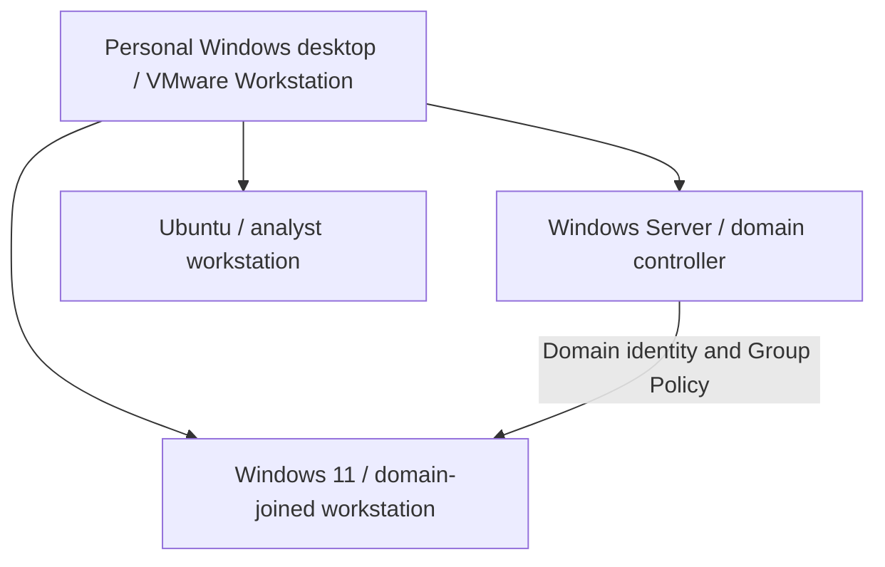

# Cybersecurity Project Collection

**SOC analysis · Identity and access management · Governance, risk and compliance**

I connect risk documentation with hands-on identity administration and authentication-log analysis. This collection presents three distinct projects together, with separate scope, results and evidence for each.

| Project | Focus and keywords | Status |
| --- | --- | --- |
| [SOC Authentication Analysis](soc.html) | Windows event logs, authentication analysis, failed-logon triage, controlled testing, investigation documentation | local log-analysis project in progress; domain-controller investigation open. |
| [IAM & Active Directory](iam.html) | Account provisioning, organizational units, security groups, domain login, Group Policy, access verification | Home lab in progress; configuration and session checks completed; evidence export/review pending. |
| [Sentinel GRC Assessment](grc.html) | Risk register, control mapping, evidence planning, remediation tracking, thematic charts | Fictional planning deliverables complete; assessment activities pending validation. Original assessment and workspace remain separate and unchanged. |

## Shared environment

The collection includes interactive IAM and SOC visual summaries and a themed GRC dashboard. These summarize documented checkpoints; they are not live directory or SIEM feeds. The showcase focuses on these three projects. [Explore the collection](index.html).

The IAM and SOC projects share this local lab. This logical view does not establish network segmentation, routing or Ubuntu domain membership. Sentinel GRC is a separate fictional assessment, not the parent assessment of these machines.

## IAM & Active Directory

**Business purpose:** practice structured employee access and workstation security-policy administration.

**My work completed:** established the domain/client environment; created employee, administrative-account, group and workstation OUs; placed the client in the workstation OU; created a fictional employee; verified employee-group membership and domain login; configured a 900-second screen-lock GPO and checked its application, registry value and computer-policy report.

**Current conclusions:** the employee group appeared in the observed session groups and Administrators did not. This is a session observation, not a complete least-privilege assessment. Screen-lock policy application was checked; timed automatic locking was not observed.

**Evidence:** HL-E-001 access note and HL-E-003 policy report are reported saved inside the Windows guest. HL-E-007–008 directory/policy screenshots need collection/export. Host export and review remain pending.

**Next:** export/review evidence, document a timed lock test and perform further account-lifecycle/resource-permission exercises. Full lifecycle management is not yet demonstrated.

## SOC Authentication Analysis

**Business purpose:** explain authentication activity, document investigation reasoning and identify visibility questions requiring further review.

**My work completed:** reviewed a successful unlock (4624, type 7); triaged a separate administrator failure (4625, status 0xC000010B, consent.exe caller); generated one authorized incorrect-password runas attempt for a fictional employee, recorded locally as 4625/status 0xC000006D/substatus 0xC000006A; reviewed domain-controller 4771/4776 results without identifying a matching failure.

**Current conclusions:** the controlled test produced a local failure event. An elevation-related cause for the separate administrator failure is suspected, not confirmed. No matching failure in reviewed domain-controller results does not establish that auditing is disabled or an event never occurred.

**Evidence:** HL-E-002 investigation note and HL-E-004–006 event exports are reported saved inside the guest. HL-E-009 audit configuration, filters, time window/time zone and authentication-path context need collection. All exports await private transfer/review.

**Next:** review audit configuration and query scope; corroborate the administrator-failure hypothesis; repeat a controlled test if appropriate. Wazuh, centralized SIEM collection, Splunk exercises and automation are planned, not deployed or demonstrated.

## Sentinel GRC Assessment — existing separate project

The [current case study](https://ronealqs2.github.io/projects/grc.html), [original brief](https://ronealqs2.github.io/grc/sentinel/) and [workspace](https://ronealqs2.github.io/grc/sentinel/workspace.html) contain four linked provisional risk/control/evidence-request/action chains. Planning deliverables are complete; evidence collection, assessment and remediation remain pending. IAM/SOC lab results do not fulfill its E-001–E-004 requests, validate its findings or close its actions. No workbook changes are proposed.

## Evidence and publication

[Evidence index and collection status](lab/evidence-index.md) · [Proposed control tests](lab/control-test-plan.md) · [Next milestones](lab/next-milestones.md)

The technical projects are home-lab work with fictional/sample business data. Notes, a policy report and event exports remain in the Windows guest; only clipboard sharing has been tested. Private transfer and review are needed before publishing sanitized excerpts. The evidence index lists what exists and what still needs collecting.

Keep credentials, VM images, employer records and original identifiers private. Test records should show purpose, procedure, expected/actual outcome, time zone, evidence ID, interpretation and remaining questions. A documented observation is distinct from a confirmed finding or a verified remediation.

## Project organization

The three peer projects share this collection. IAM and SOC share a lab foundation but have separate case studies. The original Sentinel assessment, interactive workspace and workbook remain separate; lab observations do not validate its risks or close its actions.

[Portfolio](https://ronealqs2.github.io/) · [Project collection](index.html)

**Evidence status:** IAM/SOC guest artifacts await private export and review. Public visuals summarize the owner’s checkpoint; they do not contain raw guest files.

Status confirmed November 11, 2026. This documentation update adds no new lab results.
