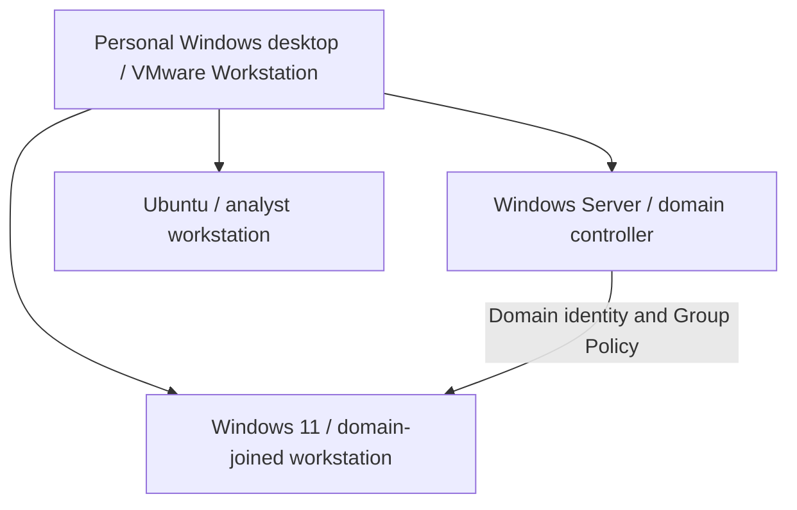

# Cybersecurity Project Collection

**SOC analysis · Identity and access management · Governance, risk and compliance**

I connect risk documentation with hands-on identity administration and authentication-log analysis. This collection presents three distinct projects together, with separate scope, results and evidence for each.

| Project | Focus and keywords | Status |
| --- | --- | --- |
| [SOC Authentication Analysis](soc.html) | Windows event logs, authentication analysis, failed-logon triage, controlled testing, investigation documentation | Event review, PowerShell summarization and new failure visibility documented; original cause unresolved. |
| [IAM & Active Directory](iam.html) | Account provisioning, organizational units, security groups, domain login, Group Policy, access verification | Home lab in progress; configuration/access checks and owner-confirmed15-minute lock/authentication completed; runtime evidence record outstanding. |
| [Sentinel GRC Assessment](grc.html) | Risk register, control mapping, evidence planning, remediation tracking, thematic charts | Fictional planning deliverables complete; assessment activities pending validation. Original assessment and workspace remain separate and unchanged. |

## Shared environment

The collection includes interactive IAM and SOC visual summaries and a themed GRC dashboard. These summarize documented checkpoints; they are not live directory or SIEM feeds. The showcase focuses on these three projects. [Explore the collection](index.html).

The IAM and SOC projects share this local lab. This logical view does not establish network segmentation, routing or Ubuntu domain membership. Sentinel GRC is a separate fictional assessment, not the parent assessment of these machines.

## IAM & Active Directory

**Business purpose:** practice structured employee access and workstation security-policy administration.

**My work completed:** established the domain/client environment; created employee, administrative-account, group and workstation OUs; placed the client in the workstation OU; created a fictional employee; verified employee-group membership and domain login; configured a 900-second screen-lock GPO and checked its application, registry value and computer-policy report.

**Current conclusions:** the employee group appeared in the observed session groups and Administrators did not. This is a session observation, not a complete least-privilege assessment. Screen-lock policy application was checked; the project owner confirmed automatic locking after15minutes idle and authentication to resume. Retained runtime timing evidence remains outstanding.

**Evidence:** HL-E-001 access note and HL-E-003 policy report privately transferred and reviewed. HL-E-013 timed behavior confirmed by the owner; retained timing evidence outstanding. HL-E-007–008 screenshots remain to be retained.

**Next:** retain the runtime timing record and perform further account-lifecycle/resource-permission exercises. Full lifecycle management is not yet demonstrated.

## SOC Authentication Analysis

**Business purpose:** explain authentication activity, document investigation reasoning and identify visibility questions requiring further review.

**My work completed:** reviewed a successful unlock (4624, type 7); triaged a separate administrator failure (4625, status 0xC000010B, consent.exe caller); generated one authorized incorrect-password runas attempt for a fictional employee, recorded locally as 4625/status 0xC000006D/substatus 0xC000006A; reviewed domain-controller 4771/4776 results without identifying a matching failure.

**Current conclusions:** the historical workstation failure is documented; the original missing domain match remains unresolved. A separate new case preserved pre-change evidence, changed two audit subcategories from Success only to Success and Failure, and recorded later employee Kerberos failures. One network source matches the workstation's earlier address, but missing console timing prevents exact single-attempt attribution. Two other employee Kerberos failures have controller-loopback context. Event counts are not human-attempt counts.

**Evidence and tool:** historical artifacts privately reviewed; all ten recorded hashes in the new case match. Built a PowerShell saved-event summary tool with27initial checks against real exports, empty results, missing fields and UTC boundaries. Later checked real4771XMLfields separately with an offline reader. Original logs and identifiers remain private. [Sanitized case review](lab/authentication-review.md) · [Tool and validation](lab/tools/README.md).

**Next:** extend repeatable investigations with complete attempt provenance. Wazuh, centralized SIEM collection, Splunk and wider automation remain planned. A later result does not prove the original cause.

## Sentinel GRC Assessment — existing separate project

The [current case study](https://ronealqs2.github.io/projects/grc.html), [original brief](https://ronealqs2.github.io/grc/sentinel/) and [workspace](https://ronealqs2.github.io/grc/sentinel/workspace.html) contain four linked provisional risk/control/evidence-request/action chains. Planning deliverables are complete; evidence collection, assessment and remediation remain pending. IAM/SOC lab results do not fulfill its E-001–E-004 requests, validate its findings or close its actions. No workbook changes are proposed.

## Evidence and publication

[Evidence index and collection status](lab/evidence-index.md) · [Proposed control tests](lab/control-test-plan.md) · [Next milestones](lab/next-milestones.md)

The technical projects are home-lab work with fictional/sample business data. Historical notes, the policy report and event exports have been privately transferred and reviewed. The new case preserves before/after exports separately. Public summaries omit raw identifiers and files. The evidence index lists what exists and what still needs collecting.

Keep credentials, VM images, employer records and original identifiers private. Test records should show purpose, procedure, expected/actual outcome, time zone, evidence ID, interpretation and remaining questions. A documented observation is distinct from a confirmed finding or a verified remediation.

## Project organization

The three peer projects share this collection. IAM and SOC share a lab foundation but have separate case studies. The original Sentinel assessment, interactive workspace and workbook remain separate; lab observations do not validate its risks or close its actions.

[Portfolio](https://ronealqs2.github.io/) · [Project collection](index.html)

**Evidence status:** private artifact review completed for the received material; raw files excluded. Owner-confirmed timed locking is distinguished from retained artifact review.

Updated November12,2026 with verified SOC evidence/tool work and owner-confirmed IAM timed behavior.
