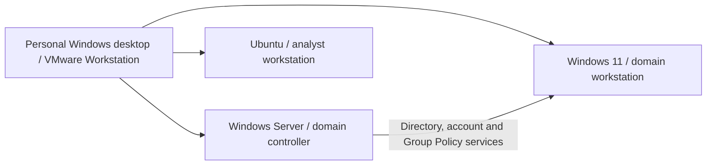

# Sentinel cybersecurity home lab

**IAM administration · SOC authentication analysis · GRC control documentation**

The lab supports two peer case studies: [IAM & Active Directory](https://ronealqs2.github.io/projects/iam.html) and [SOC Authentication Analysis](https://ronealqs2.github.io/projects/soc.html). Sentinel is a fictional cybersecurity-company scenario. Training systems and sample business data are separate from actual business operations.

This is a logical role diagram, not a claim of network segmentation or Ubuntu domain membership.

## Completed checkpoint

- Configured the Windows domain and joined the Windows client.
- Created four OUs and a fictional employee account with employee-group membership.
- Verified domain login and observed session groups; Administrators was absent from that observed session.
- Configured a 900-second screen-lock GPO and checked its application, registry value and HTML policy report. The project owner confirmed15-minute automatic locking and authentication to resume; retained runtime timing evidence remains outstanding.
- Reviewed a successful-unlock event and two failure examples, including one authorized incorrect-password test that produced a workstation event 4625.
- Investigated domain-controller authentication visibility; no matching failure was identified in the reviewed 4771/4776 results. Reviewed effective audit settings and preserved new-case evidence before enabling two failure-audit subcategories; later employee4771events were observed. Historical cause and exact single-attempt attribution remain unresolved.

## Evidence and next tests

- [Evidence index](evidence-index.md): artifact IDs, availability, review status and conclusions they can support.
- [Control-test plan](control-test-plan.md): timed locking, lifecycle/access review and authentication-audit follow-up.
- [Milestones](next-milestones.md): evidence export, one SIEM workflow and later scripting practice.

Historical notes, policy report and event exports have been privately transferred and reviewed. A separate new-case before/after review and tool validation are documented in the [sanitized authentication review](authentication-review.md). Screenshots and future test results must be collected before they can be presented as evidence. There are no raw event or report attachments here.

## Relationship to Sentinel GRC

[Sentinel GRC Assessment](https://ronealqs2.github.io/projects/grc.html) retains its own workbook, risks, proposed tests, evidence requests and action plans. Illustrative lab control mappings do not fulfill its evidence requests, establish its findings or close its actions.

Updated November12,2026. [PowerShell tool and validation](tools/README.md).
